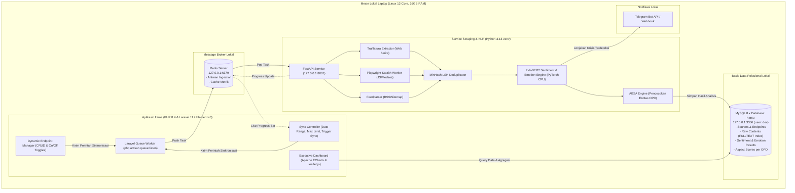

# SYSTEM ARCHITECTURE & DATA SPECIFICATION (MYSQL VERSION)
## Proyek: SISMANTIK (Lingkungan Laptop Lokal - Non-Docker)

---

### 1. Diagram Arsitektur Proses Native



---

### 2. Konfigurasi Koneksi Database (`.env` Laravel)

```ini
DB_CONNECTION=mysql
DB_HOST=127.0.0.1
DB_PORT=3306
DB_DATABASE=hantu
DB_USERNAME=dev
DB_PASSWORD=mbg

QUEUE_CONNECTION=redis
REDIS_HOST=127.0.0.1
REDIS_PASSWORD=null
REDIS_PORT=6379

PYTHON_ENGINE_URL=http://127.0.0.1:8001
```

---

### 3. Skema Basis Data Relasional MySQL (DDL Blueprint)

Skema di bawah ini 100% kompatibel dengan **MySQL 8.x** menggunakan storage engine **InnoDB** dan karakter set **utf8mb4** untuk mendukung penuh teks berita, karakter lokal, serta emotikon media sosial.

```sql
-- 1. TABEL SUMBER DATA UTAMA (SOURCES)
CREATE TABLE `sources` (
    `id` BIGINT UNSIGNED AUTO_INCREMENT PRIMARY KEY,
    `name` VARCHAR(255) NOT NULL,
    `code` VARCHAR(100) NOT NULL UNIQUE,
    `platform_type` ENUM('web_rss', 'web_html', 'facebook', 'instagram', 'tiktok', 'x') NOT NULL,
    `base_url` VARCHAR(500) NOT NULL,
    `description` TEXT NULL,
    `is_active` TINYINT(1) DEFAULT 1,
    `sync_interval_minutes` INT DEFAULT 60,
    `last_synced_at` DATETIME NULL,
    `created_at` TIMESTAMP NULL DEFAULT CURRENT_TIMESTAMP,
    `updated_at` TIMESTAMP NULL DEFAULT CURRENT_TIMESTAMP ON UPDATE CURRENT_TIMESTAMP,
    INDEX `idx_sources_active` (`is_active`),
    INDEX `idx_sources_platform` (`platform_type`)
) ENGINE=InnoDB DEFAULT CHARSET=utf8mb4 COLLATE=utf8mb4_unicode_ci;

-- 2. TABEL ENDPOINT DINAMIS PER SUMBER DATA (SOURCE ENDPOINTS)
CREATE TABLE `source_endpoints` (
    `id` BIGINT UNSIGNED AUTO_INCREMENT PRIMARY KEY,
    `source_id` BIGINT UNSIGNED NOT NULL,
    `name` VARCHAR(255) NOT NULL,
    `endpoint_url` TEXT NOT NULL,
    `parser_type` ENUM('auto_trafilatura', 'rss', 'playwright_custom', 'social_profile') DEFAULT 'auto_trafilatura',
    `selectors_config` JSON NULL, -- CSS selectors: {"title": "h1", "content": "article", "date": "time"}
    `default_max_items` INT DEFAULT 50,
    `is_active` TINYINT(1) DEFAULT 1,
    `created_at` TIMESTAMP NULL DEFAULT CURRENT_TIMESTAMP,
    `updated_at` TIMESTAMP NULL DEFAULT CURRENT_TIMESTAMP ON UPDATE CURRENT_TIMESTAMP,
    FOREIGN KEY (`source_id`) REFERENCES `sources`(`id`) ON DELETE CASCADE,
    INDEX `idx_endpoints_active` (`is_active`)
) ENGINE=InnoDB DEFAULT CHARSET=utf8mb4 COLLATE=utf8mb4_unicode_ci;

-- 3. TABEL LOG PEKERJAAN SINKRONISASI (SYNC JOBS)
CREATE TABLE `sync_jobs` (
    `id` BIGINT UNSIGNED AUTO_INCREMENT PRIMARY KEY,
    `job_uuid` CHAR(36) NOT NULL,
    `source_id` BIGINT UNSIGNED NULL,
    `endpoint_id` BIGINT UNSIGNED NULL,
    `status` ENUM('pending', 'running', 'completed', 'failed') DEFAULT 'pending',
    `triggered_by` ENUM('system_cron', 'manual_user') DEFAULT 'system_cron',
    `start_date` DATE NULL,
    `end_date` DATE NULL,
    `max_items_limit` INT DEFAULT 50,
    `items_scraped` INT DEFAULT 0,
    `items_processed` INT DEFAULT 0,
    `log_messages` LONGTEXT NULL,
    `started_at` DATETIME NULL,
    `finished_at` DATETIME NULL,
    `created_at` TIMESTAMP NULL DEFAULT CURRENT_TIMESTAMP,
    FOREIGN KEY (`source_id`) REFERENCES `sources`(`id`) ON DELETE SET NULL,
    FOREIGN KEY (`endpoint_id`) REFERENCES `source_endpoints`(`id`) ON DELETE SET NULL,
    INDEX `idx_sync_jobs_status` (`status`)
) ENGINE=InnoDB DEFAULT CHARSET=utf8mb4 COLLATE=utf8mb4_unicode_ci;

-- 4. TABEL TOPIK & OPD / DINAS (TOPICS OR AGENCIES)
CREATE TABLE `topics_or_agencies` (
    `id` BIGINT UNSIGNED AUTO_INCREMENT PRIMARY KEY,
    `name` VARCHAR(255) NOT NULL, -- e.g. "Dinas PUPR", "Dinas Kesehatan"
    `code` VARCHAR(50) NOT NULL UNIQUE, -- 'dinas_pupr', 'dinkes'
    `category` VARCHAR(100) NULL,
    `keywords` JSON NOT NULL, -- ["jalan rusak", "aspal", "jembatan", "lubang"]
    `aliases` JSON NULL, -- ["PUPR", "Bina Marga"]
    `is_active` TINYINT(1) DEFAULT 1,
    `created_at` TIMESTAMP NULL DEFAULT CURRENT_TIMESTAMP,
    `updated_at` TIMESTAMP NULL DEFAULT CURRENT_TIMESTAMP ON UPDATE CURRENT_TIMESTAMP,
    INDEX `idx_topics_active` (`is_active`)
) ENGINE=InnoDB DEFAULT CHARSET=utf8mb4 COLLATE=utf8mb4_unicode_ci;

-- 5. TABEL KONTEN MENTAH HASIL SCRAPING (RAW CONTENTS)
CREATE TABLE `raw_contents` (
    `id` BIGINT UNSIGNED AUTO_INCREMENT PRIMARY KEY,
    `source_endpoint_id` BIGINT UNSIGNED NULL,
    `sync_job_id` BIGINT UNSIGNED NULL,
    `external_id` VARCHAR(500) NULL,
    `author` VARCHAR(255) NULL,
    `title` VARCHAR(500) NULL,
    `content_text` LONGTEXT NOT NULL,
    `clean_text` LONGTEXT NULL,
    `url` TEXT NOT NULL,
    `content_hash` CHAR(64) NOT NULL, -- SHA-256
    `minhash_signature` TEXT NULL,
    `is_duplicate` TINYINT(1) DEFAULT 0,
    `parent_id` BIGINT UNSIGNED NULL,
    `published_at` DATETIME NULL,
    `engagement_metrics` JSON NULL, -- {"likes": 120, "comments": 45, "shares": 12}
    `is_analyzed` TINYINT(1) DEFAULT 0,
    `is_suspected_bot` TINYINT(1) DEFAULT 0,
    `bot_suspicion_reason` VARCHAR(255) NULL,
    `created_at` TIMESTAMP NULL DEFAULT CURRENT_TIMESTAMP,
    FOREIGN KEY (`source_endpoint_id`) REFERENCES `source_endpoints`(`id`) ON DELETE SET NULL,
    FOREIGN KEY (`sync_job_id`) REFERENCES `sync_jobs`(`id`) ON DELETE SET NULL,
    FOREIGN KEY (`parent_id`) REFERENCES `raw_contents`(`id`) ON DELETE SET NULL,
    INDEX `idx_raw_contents_hash` (`content_hash`),
    INDEX `idx_raw_contents_published` (`published_at`),
    INDEX `idx_raw_contents_analyzed` (`is_analyzed`),
    FULLTEXT INDEX `ft_title_content` (`title`, `content_text`)
) ENGINE=InnoDB DEFAULT CHARSET=utf8mb4 COLLATE=utf8mb4_unicode_ci;

-- 6. TABEL HASIL ANALISIS SENTIMEN & EMOSI (SENTIMENT RESULTS)
CREATE TABLE `sentiment_results` (
    `id` BIGINT UNSIGNED AUTO_INCREMENT PRIMARY KEY,
    `raw_content_id` BIGINT UNSIGNED NOT NULL,
    `sentiment_label` ENUM('positive', 'neutral', 'negative') NOT NULL,
    `sentiment_score` DECIMAL(6,4) NOT NULL, -- -1.0000 s/d +1.0000
    `confidence_score` DECIMAL(6,4) NOT NULL, -- 0.0000 s/d 1.0000
    `emotion_label` VARCHAR(50) NULL, -- 'marah', 'kecewa', 'takut', 'sedih', 'apresiasi', 'harapan'
    `emotion_scores` JSON NULL,
    `analyzed_by_model` VARCHAR(100) DEFAULT 'indobert-smsa-v1',
    `created_at` TIMESTAMP NULL DEFAULT CURRENT_TIMESTAMP,
    FOREIGN KEY (`raw_content_id`) REFERENCES `raw_contents`(`id`) ON DELETE CASCADE,
    INDEX `idx_sentiment_label` (`sentiment_label`),
    INDEX `idx_sentiment_score` (`sentiment_score`)
) ENGINE=InnoDB DEFAULT CHARSET=utf8mb4 COLLATE=utf8mb4_unicode_ci;

-- 7. TABEL ASPECT-BASED SENTIMENT PER INSTANSI / OPD (ASPECT SENTIMENTS)
CREATE TABLE `aspect_sentiments` (
    `id` BIGINT UNSIGNED AUTO_INCREMENT PRIMARY KEY,
    `sentiment_result_id` BIGINT UNSIGNED NOT NULL,
    `agency_id` BIGINT UNSIGNED NOT NULL,
    `aspect_keyword` VARCHAR(255) NULL,
    `aspect_sentiment_label` ENUM('positive', 'neutral', 'negative') NOT NULL,
    `aspect_score` DECIMAL(6,4) NOT NULL,
    `created_at` TIMESTAMP NULL DEFAULT CURRENT_TIMESTAMP,
    FOREIGN KEY (`sentiment_result_id`) REFERENCES `sentiment_results`(`id`) ON DELETE CASCADE,
    FOREIGN KEY (`agency_id`) REFERENCES `topics_or_agencies`(`id`) ON DELETE CASCADE
) ENGINE=InnoDB DEFAULT CHARSET=utf8mb4 COLLATE=utf8mb4_unicode_ci;

-- 8. TABEL EKSTRAKSI GEOSPASIAL KECAMATAN / DESA (GEO EXTRACTIONS)
CREATE TABLE `geo_extractions` (
    `id` BIGINT UNSIGNED AUTO_INCREMENT PRIMARY KEY,
    `raw_content_id` BIGINT UNSIGNED NOT NULL,
    `district_name` VARCHAR(150) NULL,
    `subdistrict_name` VARCHAR(150) NULL,
    `latitude` DECIMAL(10,7) NULL,
    `longitude` DECIMAL(10,7) NULL,
    `match_confidence` DECIMAL(5,4) NULL,
    `created_at` TIMESTAMP NULL DEFAULT CURRENT_TIMESTAMP,
    FOREIGN KEY (`raw_content_id`) REFERENCES `raw_contents`(`id`) ON DELETE CASCADE,
    INDEX `idx_geo_district` (`district_name`)
) ENGINE=InnoDB DEFAULT CHARSET=utf8mb4 COLLATE=utf8mb4_unicode_ci;

-- 9. TABEL ATURAN EARLY WARNING & ALERT KRISIS (ALERT RULES)
CREATE TABLE `alert_rules` (
    `id` BIGINT UNSIGNED AUTO_INCREMENT PRIMARY KEY,
    `name` VARCHAR(255) NOT NULL,
    `topic_id` BIGINT UNSIGNED NULL,
    `metric_type` VARCHAR(50) DEFAULT 'negative_percentage_spike',
    `threshold_value` DECIMAL(6,2) DEFAULT 40.00,
    `window_hours` INT DEFAULT 2,
    `notification_target` VARCHAR(100) DEFAULT 'telegram_group_humas',
    `is_active` TINYINT(1) DEFAULT 1,
    `created_at` TIMESTAMP NULL DEFAULT CURRENT_TIMESTAMP,
    FOREIGN KEY (`topic_id`) REFERENCES `topics_or_agencies`(`id`) ON DELETE SET NULL
) ENGINE=InnoDB DEFAULT CHARSET=utf8mb4 COLLATE=utf8mb4_unicode_ci;

-- 10. TABEL LOG RINGKASAN EKSEKUTIF HARIAN (AI EXECUTIVE SUMMARIES)
CREATE TABLE `ai_executive_summaries` (
    `id` BIGINT UNSIGNED AUTO_INCREMENT PRIMARY KEY,
    `summary_date` DATE NOT NULL UNIQUE,
    `key_highlights` JSON NOT NULL,
    `root_causes` JSON NOT NULL,
    `recommended_actions` JSON NOT NULL,
    `raw_summary_text` TEXT NULL,
    `created_at` TIMESTAMP NULL DEFAULT CURRENT_TIMESTAMP
) ENGINE=InnoDB DEFAULT CHARSET=utf8mb4 COLLATE=utf8mb4_unicode_ci;
```
