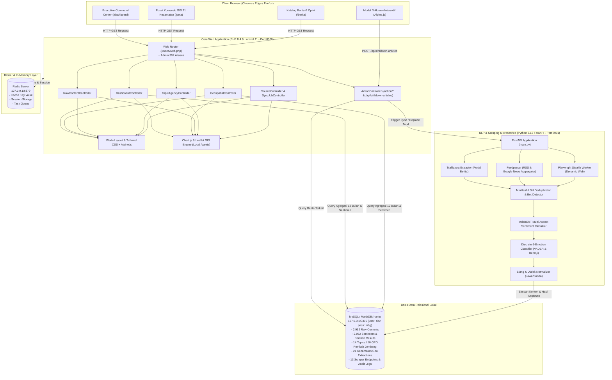

# SYSTEM ARCHITECTURE & DATA SPECIFICATION
## Proyek: SISMANTIK PRO (Native Local Linux & MySQL Architecture)

---

### 1. Diagram Arsitektur Komprehensif Sistem



---

### 2. Konfigurasi Lingkungan (`core-web/.env`)

```ini
APP_NAME=SISMANTIK
APP_ENV=local
APP_KEY=base64:vAyLu6FNvvXK3QOJPDZklAKHeNlomsjlNVfy8HEEXVk=
APP_DEBUG=true
APP_URL=http://localhost:8000

APP_LOCALE=id
APP_FALLBACK_LOCALE=en
APP_FAKER_LOCALE=id_ID

DB_CONNECTION=mysql
DB_HOST=127.0.0.1
DB_PORT=3306
DB_DATABASE=hantu
DB_USERNAME=dev
DB_PASSWORD=mbg

SESSION_DRIVER=database
SESSION_LIFETIME=120

QUEUE_CONNECTION=redis
CACHE_STORE=redis

REDIS_CLIENT=predis
REDIS_HOST=127.0.0.1
REDIS_PORT=6379

PYTHON_ENGINE_URL=http://127.0.0.1:8001
```

---

### 3. Skema Basis Data Relasional MySQL (DDL Spesifikasi Nyata)

#### 1. Tabel Portal & Sumber Media (`sources`)
```sql
CREATE TABLE `sources` (
    `id` BIGINT UNSIGNED AUTO_INCREMENT PRIMARY KEY,
    `name` VARCHAR(255) NOT NULL,
    `code` VARCHAR(100) NOT NULL UNIQUE,
    `platform_type` VARCHAR(50) NOT NULL, -- 'web_rss', 'web_html', 'social_media'
    `tier` VARCHAR(20) DEFAULT 'tier_2',   -- 'tier_1', 'tier_2', 'tier_3', 'tier_4'
    `authority_score` DECIMAL(4,2) DEFAULT 1.00,
    `base_url` VARCHAR(500) NOT NULL,
    `description` TEXT NULL,
    `is_active` TINYINT(1) DEFAULT 1,
    `sync_interval_minutes` INT DEFAULT 60,
    `last_synced_at` DATETIME NULL,
    `created_at` TIMESTAMP NULL DEFAULT CURRENT_TIMESTAMP,
    `updated_at` TIMESTAMP NULL DEFAULT CURRENT_TIMESTAMP ON UPDATE CURRENT_TIMESTAMP
) ENGINE=InnoDB DEFAULT CHARSET=utf8mb4 COLLATE=utf8mb4_unicode_ci;
```

#### 2. Tabel Endpoint Pengambil Data (`source_endpoints`)
```sql
CREATE TABLE `source_endpoints` (
    `id` BIGINT UNSIGNED AUTO_INCREMENT PRIMARY KEY,
    `source_id` BIGINT UNSIGNED NOT NULL,
    `name` VARCHAR(255) NOT NULL,
    `endpoint_url` VARCHAR(1000) NOT NULL,
    `parser_type` VARCHAR(50) NOT NULL, -- 'rss', 'trafilatura', 'playwright'
    `scope` VARCHAR(50) DEFAULT 'all',  -- 'all', 'local_pemkab', 'national_strategic'
    `selectors_config` JSON NULL,
    `default_max_items` INT DEFAULT 50,
    `is_active` TINYINT(1) DEFAULT 1,
    `created_at` TIMESTAMP NULL DEFAULT CURRENT_TIMESTAMP,
    `updated_at` TIMESTAMP NULL DEFAULT CURRENT_TIMESTAMP ON UPDATE CURRENT_TIMESTAMP,
    FOREIGN KEY (`source_id`) REFERENCES `sources`(`id`) ON DELETE CASCADE
) ENGINE=InnoDB DEFAULT CHARSET=utf8mb4 COLLATE=utf8mb4_unicode_ci;
```

#### 3. Tabel Topik & Instansi OPD (`topics_or_agencies`)
```sql
CREATE TABLE `topics_or_agencies` (
    `id` BIGINT UNSIGNED AUTO_INCREMENT PRIMARY KEY,
    `name` VARCHAR(255) NOT NULL,
    `code` VARCHAR(100) NOT NULL UNIQUE,
    `category` VARCHAR(100) DEFAULT 'Pemerintahan',
    `scope` VARCHAR(50) DEFAULT 'local_pemkab', -- 'local_pemkab', 'national_strategic'
    `keywords` JSON NOT NULL,
    `aliases` JSON NULL,
    `is_active` TINYINT(1) DEFAULT 1,
    `created_at` TIMESTAMP NULL DEFAULT CURRENT_TIMESTAMP,
    `updated_at` TIMESTAMP NULL DEFAULT CURRENT_TIMESTAMP ON UPDATE CURRENT_TIMESTAMP
) ENGINE=InnoDB DEFAULT CHARSET=utf8mb4 COLLATE=utf8mb4_unicode_ci;
```

#### 4. Tabel Konten Berita Mentah (`raw_contents`)
```sql
CREATE TABLE `raw_contents` (
    `id` BIGINT UNSIGNED AUTO_INCREMENT PRIMARY KEY,
    `source_endpoint_id` BIGINT UNSIGNED NULL,
    `sync_job_id` BIGINT UNSIGNED NULL,
    `external_id` TEXT NULL,
    `author` VARCHAR(255) NULL,
    `title` VARCHAR(500) NULL,
    `content_text` LONGTEXT NULL,
    `clean_text` LONGTEXT NULL,
    `url` VARCHAR(1000) NULL,
    `content_hash` VARCHAR(64) NULL,
    `minhash_signature` JSON NULL,
    `is_duplicate` TINYINT(1) DEFAULT 0,
    `scope` VARCHAR(50) DEFAULT 'local_pemkab', -- 'local_pemkab', 'national_strategic'
    `parent_id` BIGINT UNSIGNED NULL,
    `published_at` DATETIME NULL,
    `engagement_metrics` JSON NULL,
    `is_analyzed` TINYINT(1) DEFAULT 0,
    `is_suspected_bot` TINYINT(1) DEFAULT 0,
    `bot_suspicion_reason` VARCHAR(255) NULL,
    `created_at` TIMESTAMP NULL DEFAULT CURRENT_TIMESTAMP,
    `updated_at` TIMESTAMP NULL DEFAULT CURRENT_TIMESTAMP ON UPDATE CURRENT_TIMESTAMP,
    INDEX `idx_raw_published` (`published_at`),
    INDEX `idx_raw_scope` (`scope`),
    INDEX `idx_raw_analyzed` (`is_analyzed`),
    FULLTEXT INDEX `idx_raw_text_search` (`title`, `clean_text`)
) ENGINE=InnoDB DEFAULT CHARSET=utf8mb4 COLLATE=utf8mb4_unicode_ci;
```

#### 5. Tabel Hasil Sentimen & Analisis Emosi (`sentiment_results`)
```sql
CREATE TABLE `sentiment_results` (
    `id` BIGINT UNSIGNED AUTO_INCREMENT PRIMARY KEY,
    `raw_content_id` BIGINT UNSIGNED NOT NULL,
    `sentiment_label` ENUM('positive', 'neutral', 'negative') NOT NULL,
    `confidence_score` DECIMAL(5,4) NOT NULL,
    `emotion_label` VARCHAR(50) NULL, -- 'apresiasi', 'harapan', 'kecewa', 'marah', 'sedih', 'takut'
    `framing_category` VARCHAR(100) NULL, -- 'Infrastruktur', 'Kesehatan', 'Pertanian', dll.
    `explanation` TEXT NULL,
    `model_version` VARCHAR(50) DEFAULT 'IndoBERT-VADER-v1.0',
    `created_at` TIMESTAMP NULL DEFAULT CURRENT_TIMESTAMP,
    `updated_at` TIMESTAMP NULL DEFAULT CURRENT_TIMESTAMP ON UPDATE CURRENT_TIMESTAMP,
    FOREIGN KEY (`raw_content_id`) REFERENCES `raw_contents`(`id`) ON DELETE CASCADE,
    INDEX `idx_sentiment_label` (`sentiment_label`),
    INDEX `idx_emotion_label` (`emotion_label`)
) ENGINE=InnoDB DEFAULT CHARSET=utf8mb4 COLLATE=utf8mb4_unicode_ci;
```

#### 6. Tabel Ekstraksi Geospasial Kecamatan (`geo_extractions`)
```sql
CREATE TABLE `geo_extractions` (
    `id` BIGINT UNSIGNED AUTO_INCREMENT PRIMARY KEY,
    `raw_content_id` BIGINT UNSIGNED NOT NULL,
    `district_name` VARCHAR(100) NOT NULL, -- Nama resmi dari 21 kecamatan Kab. Jombang
    `confidence` DECIMAL(4,2) DEFAULT 1.00,
    `created_at` TIMESTAMP NULL DEFAULT CURRENT_TIMESTAMP,
    `updated_at` TIMESTAMP NULL DEFAULT CURRENT_TIMESTAMP ON UPDATE CURRENT_TIMESTAMP,
    FOREIGN KEY (`raw_content_id`) REFERENCES `raw_contents`(`id`) ON DELETE CASCADE,
    INDEX `idx_district_name` (`district_name`)
) ENGINE=InnoDB DEFAULT CHARSET=utf8mb4 COLLATE=utf8mb4_unicode_ci;
```

#### 7. Tabel Log Audit Sinkronisasi (`sync_jobs`)
```sql
CREATE TABLE `sync_jobs` (
    `id` BIGINT UNSIGNED AUTO_INCREMENT PRIMARY KEY,
    `job_uuid` VARCHAR(100) NOT NULL UNIQUE,
    `source_id` BIGINT UNSIGNED NULL,
    `endpoint_id` BIGINT UNSIGNED NULL,
    `status` VARCHAR(50) DEFAULT 'pending', -- 'pending', 'running', 'completed', 'failed'
    `triggered_by` VARCHAR(100) DEFAULT 'system_cron',
    `start_date` DATE NULL,
    `end_date` DATE NULL,
    `max_items_limit` INT DEFAULT 50,
    `items_scraped` INT DEFAULT 0,
    `items_processed` INT DEFAULT 0,
    `log_messages` LONGTEXT NULL,
    `started_at` DATETIME NULL,
    `finished_at` DATETIME NULL,
    `created_at` TIMESTAMP NULL DEFAULT CURRENT_TIMESTAMP,
    `updated_at` TIMESTAMP NULL DEFAULT CURRENT_TIMESTAMP ON UPDATE CURRENT_TIMESTAMP
) ENGINE=InnoDB DEFAULT CHARSET=utf8mb4 COLLATE=utf8mb4_unicode_ci;

CREATE TABLE `stopwords` (
    `id` BIGINT UNSIGNED AUTO_INCREMENT PRIMARY KEY,
    `word` VARCHAR(100) NOT NULL UNIQUE,
    `category` VARCHAR(50) NOT NULL DEFAULT 'umum', -- 'daerah', 'waktu', 'angka', 'sapaan_gelar', 'aksi_umum', 'umum'
    `is_active` TINYINT(1) NOT NULL DEFAULT 1,
    `created_at` TIMESTAMP NULL DEFAULT CURRENT_TIMESTAMP,
    `updated_at` TIMESTAMP NULL DEFAULT CURRENT_TIMESTAMP ON UPDATE CURRENT_TIMESTAMP,
    INDEX `idx_stopwords_cat_active` (`category`, `is_active`)
) ENGINE=InnoDB DEFAULT CHARSET=utf8mb4 COLLATE=utf8mb4_unicode_ci;
```

---

### 4. Perintah Artisan Khusus SISMANTIK

* **`php artisan sismantik:sync {--max=20}`**  
  Menjalankan sinkronisasi penarikan berita terbaru secara bertahap (*incremental*).
* **`php artisan sismantik:sync-historical {--months=12} {--max-per-month=1000}`**  
  Menarik data histori berita 12 bulan terakhir tanpa menghapus data yang sudah ada.
* **`php artisan sismantik:replace-total {--months=12} {--max-per-month=1000} {--confirm=yes}`**  
  Mengosongkan tabel `raw_contents`, `sentiment_results`, dan `geo_extractions`, kemudian menarik ulang data segar 12 bulan terakhir dan langsung menganalisisnya melalui Python NLP Engine.
* **`php artisan sismantik:analyze-content`**  
  Memindai seluruh data `raw_contents` yang berstatus `is_analyzed = 0` dan mengirimkannya ke microservice FastAPI untuk dianalisis sentimen dan entitasnya.
